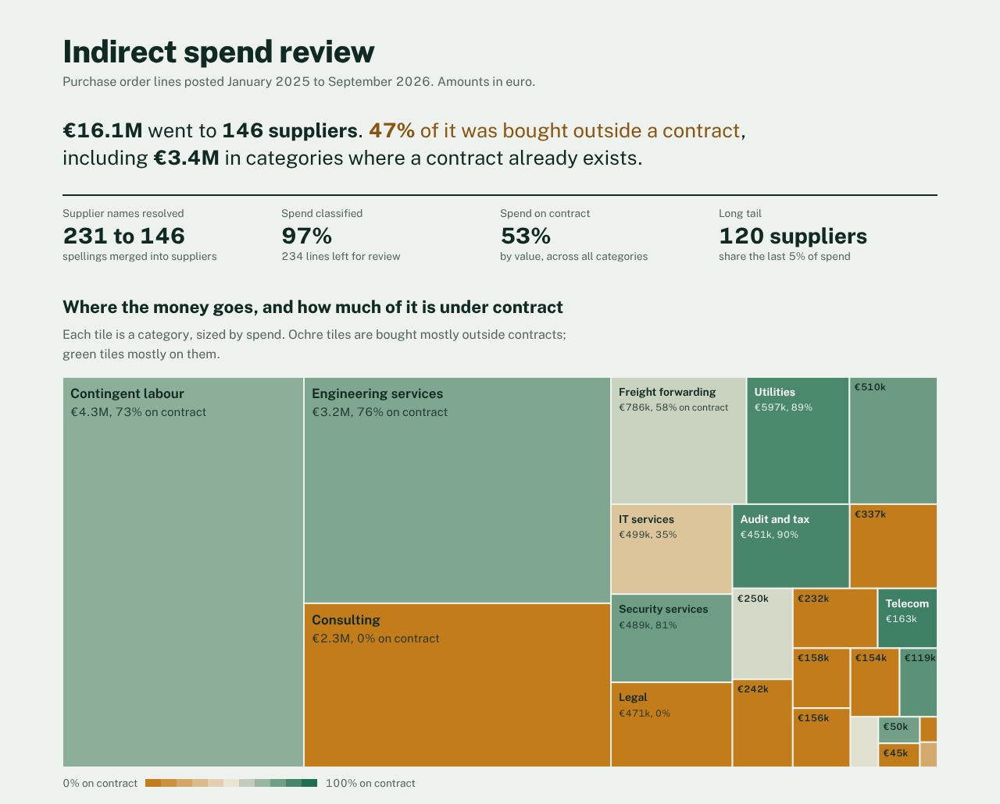

# Procurement spend cube

**Live report:** https://awaisq5.github.io/procurement-spend-cube/

Before a procurement team can negotiate, it needs to know what it buys and from whom. ERP exports rarely say: one supplier appears under five spellings, line descriptions read "Services as per PO", and amounts arrive in four currencies. This project turns such an export into a **spend cube** (spend by category, supplier and quarter) and a report that says where to act first.



## Why I built it

In a global commodity rotation I normalised supplier data to identify $365M of indirect on-contract spend across professional and labour services. Most of that work was cleaning: deciding which supplier names are the same company, and which category a line belongs to. This project automates those steps and, unlike a spreadsheet, measures how accurate it is.

## What it does

**1. Resolves supplier names.** Names are folded (umlauts, case, punctuation), legal forms and locations are stripped, and the result is matched by fuzzy similarity within each country, then joined with union-find. A guard keeps "Becker Elektro" and "Becker Druck" apart even though they share a name.

**2. Classifies spend in three layers, cheapest and most explainable first:**

| Layer | How | Why |
|---|---|---|
| Keyword rules | English and German keywords per category, on word boundaries with German compound support | Fast, free, auditable |
| Supplier profile | A supplier with 80%+ of its classified spend in one category lends it to its vague lines | Fixes "Monthly fee" without guessing |
| Language model (optional) | Leftovers go to any OpenAI-compatible endpoint: OpenRouter, or Ollama on your own machine | Handles what rules cannot |

The language model layer is built to be safe to point at real company data:

- it sends **only line descriptions**, never supplier names, amounts or cost centres (a test enforces this);
- answers outside the taxonomy, or for ids it was not asked about, are discarded;
- low-confidence answers go to the review queue instead of the cube;
- answers are cached on disk, so re-running never pays twice.

Every line records which layer classified it and with what confidence.

**3. Builds the cube in DuckDB.** SQL computes contract coverage, concentration (HHI) per category, the supplier Pareto curve, the long tail, and leakage: spend outside contracts in categories where a contract exists.

**4. Writes a report** as one self-contained HTML file (charts are hand-built SVG, the font is embedded), plus CSV extracts: classified lines, supplier map, categories and a review queue sorted by value.

## How accurate is it?

The sample data comes with ground truth for every line, so accuracy is measured, not claimed:

```text
$ spendcube evaluate data/spend_lines.csv --fx data/fx_rates.csv --truth data/ground_truth.csv
Supplier matching   precision 100.0%   recall 97.6%
Classification      precision 99.9%   coverage 91.3%
  rule        2083 lines   100.0% correct
  supplier     383 lines   99.5% correct
```

Read these numbers with care: the synthetic descriptions are cleaner than real ones, so rule precision on a real export will be lower. The value is the harness. Label a few hundred real lines, run `evaluate`, and you know where you stand before anyone relies on the cube. Tests fail if accuracy on the sample drops below set thresholds.

## Running it

```bash
python -m venv .venv && source .venv/bin/activate
pip install -e ".[dev]"

spendcube run data/spend_lines.csv --fx data/fx_rates.csv --out report
open report/index.html

# Optional: classify leftovers with a language model
OPENROUTER_API_KEY=... spendcube run data/spend_lines.csv --fx data/fx_rates.csv --out report --llm openrouter
spendcube run data/spend_lines.csv --fx data/fx_rates.csv --out report --llm ollama   # local, nothing leaves the machine

pytest
```

### Input

A purchase order line export (SAP ME2N/ME80FN or an Ariba spend report both work after renaming columns):

| Column | Required | Notes |
|---|---|---|
| `po_number`, `posting_date` | yes | date as YYYY-MM-DD |
| `supplier_name`, `supplier_country` | yes | raw, as exported |
| `description`, `amount`, `currency` | yes | any currency listed in the rates file |
| `contract_id` | no | blank means off contract |

Exchange rates come from a small CSV (`currency, eur_per_unit`). The sample rates are illustrative.

## Project structure

```
src/spendcube/text.py        name and description normalisation
src/spendcube/suppliers.py   fuzzy supplier matching with union-find
src/spendcube/taxonomy.py    24 indirect categories, English and German keywords
src/spendcube/classify.py    rules, supplier profile, language model layer with cache
src/spendcube/analytics.py   the cube in DuckDB SQL, findings per category
src/spendcube/charts.py      squarified treemap and Pareto curve as SVG
src/spendcube/report.py      HTML report and CSV extracts
src/spendcube/evaluate.py    precision and recall against ground truth
scripts/make_sample_data.py  synthetic export with ground truth
```

## Limits and next steps

- The taxonomy is a compact indirect-spend tree. Mapping it to UNSPSC codes would let the cube compare with benchmarks.
- Matching works within a country. A group supplier invoicing from several countries appears once per country, which is often what a buyer wants, but not always.
- Supplier risk signals (financial health, sanctions lists) would sit naturally next to the concentration findings.

## License

MIT. The embedded Public Sans font is under the SIL Open Font License (see `src/spendcube/assets/PublicSans-OFL.txt`).
